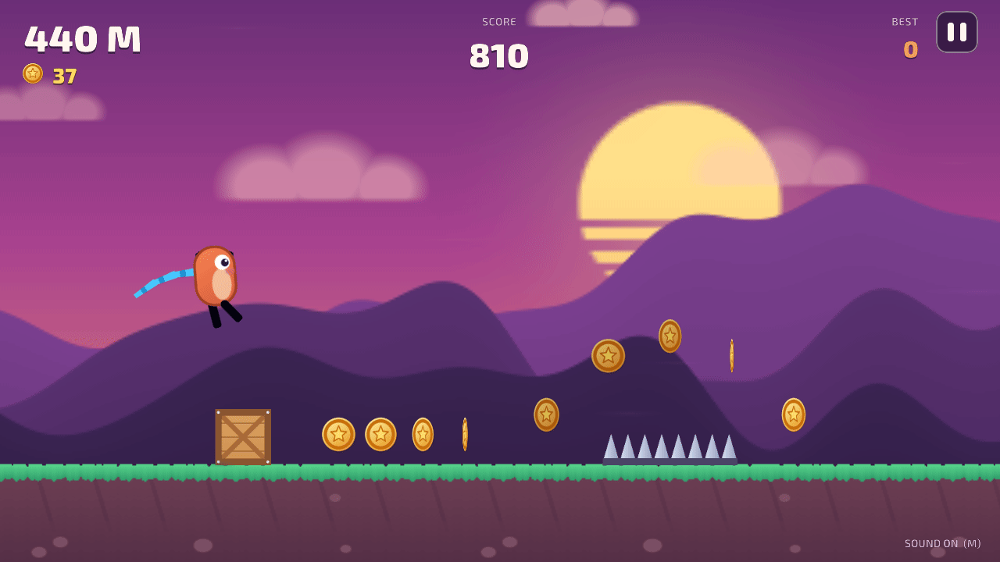
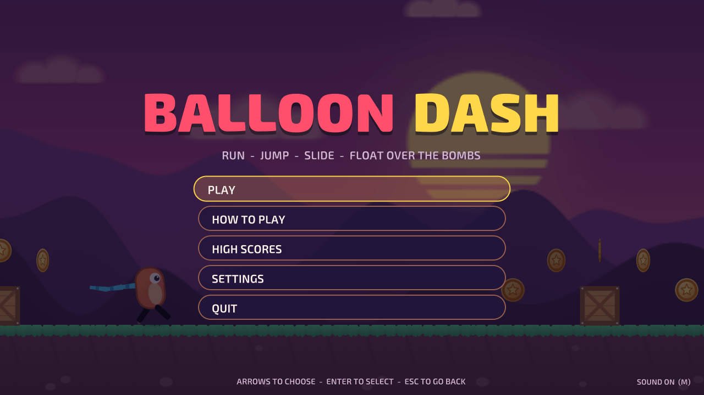
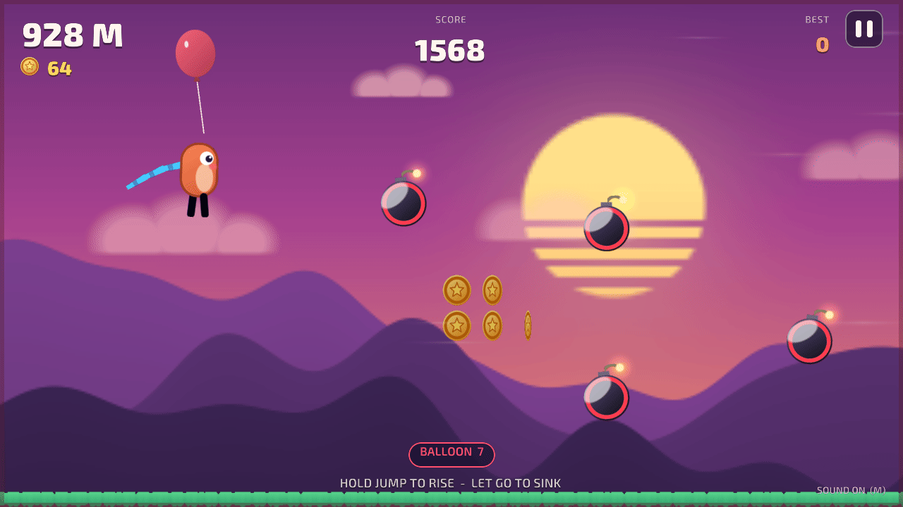
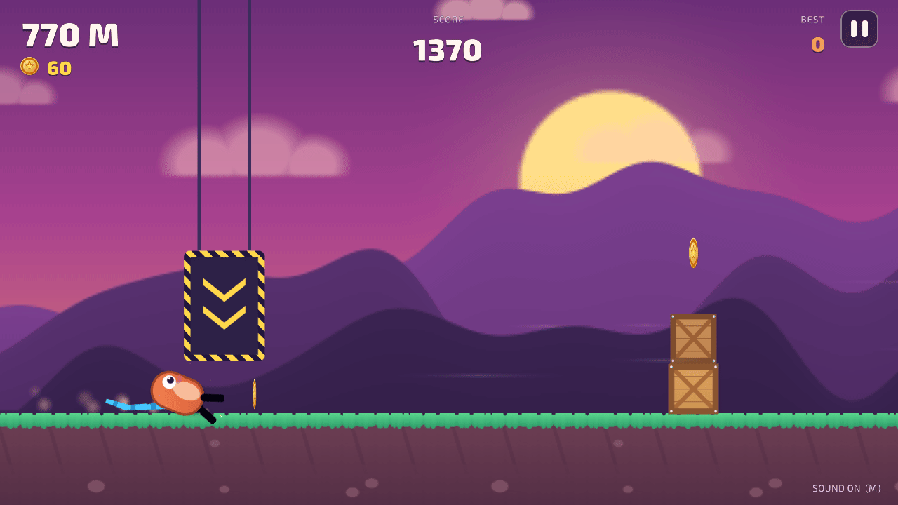
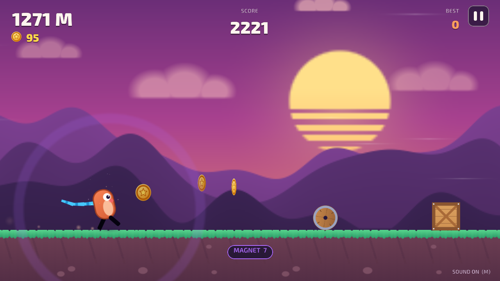
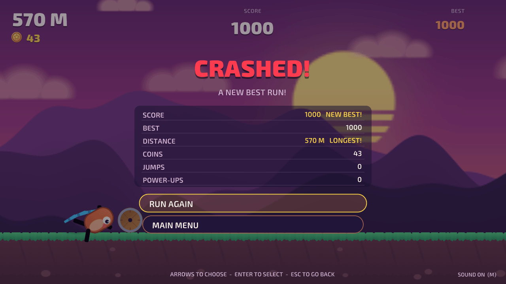
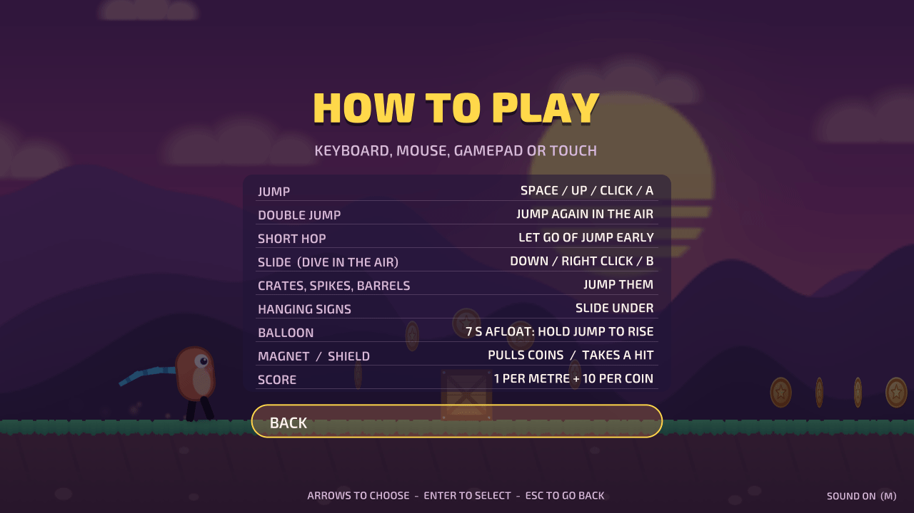

# Balloon Dash

A sunset arcade runner built with Unity: jump crates and spikes, slide under hanging signs,
double-jump stacks and rolling barrels, collect coins, and grab a balloon to float over the
track between bombs. The track speeds up the further you run; one hit ends the run. Plays with
a keyboard, a mouse, a gamepad or a touch screen.

It started in 2021 as my take on **Unit 3 "Sound and Effects" of the Unity Learn Junior
Programmer pathway** (Prototype 3, the runner, and Challenge 3, the balloon), and was rebuilt
on those two ideas as an original game (see [Where it came from](#where-it-came-from)).



| | |
|---|---|
|  |  |
|  |  |
|  |  |

## Run it

1. Install **Unity 6000.3.27f1 (Unity 6 LTS)** with Unity Hub (add the Windows or Web build
   support module if you want to build players).
2. In Unity Hub choose **Add → Add project from disk** and select the repository folder.
3. Open `Assets/Scenes/Main.unity` and press **Play**.

To build a player use **File → Build Profiles** (Windows or Web), or build from a terminal into
a folder outside the repository:

```bash
Unity -batchmode -quit -projectPath . -executeMethod BalloonDash.EditorTools.ProjectBuilder.BuildWebGL -buildOutput ../build/web
```

(`BuildWindows` works the same way.) The WebGL build is uncompressed, so it runs from any
static host such as GitHub Pages.

The tests run from **Window → General → Test Runner** (EditMode and PlayMode), or from a terminal:

```bash
Unity -batchmode -projectPath . -runTests -testPlatform EditMode -testResults results.xml
Unity -batchmode -projectPath . -runTests -testPlatform PlayMode -testResults playmode.xml
```

The scene, the particle materials, the font atlases, the icon and the player settings are
generated by **Balloon Dash → Regenerate Art, Scene and Player Settings**
(`ProjectBuilder.SetUpProject`), and the music and sounds by `python tools/audio/build.py`
(needs ffmpeg). The README screenshots come from an opt-in hook: run a built player with
`-screenshot <folder>` (optionally `-scenario title,run,slide,balloon,powers,crash,pause,howto,records,settings`),
or, without a player,
`Unity -batchmode -projectPath . -executeMethod BalloonDash.EditorTools.ProjectBuilder.CaptureScreenshots -screenshot <folder>`.

## Controls

| Action | Keyboard and mouse | Touch | Gamepad |
|---|---|---|---|
| Jump (again in the air for a double jump) | Space, W, ↑ or left click | Tap the right side of the screen | A, RB or RT |
| Short hop | Let go of jump early | Lift the finger early | Let go early |
| Rise under the balloon | Hold jump | Hold the right side | Hold A |
| Slide (in the air: dive, then slide) | S, ↓, Left Shift, Left Ctrl or right click | Tap the left side, or swipe down | B, X, LB, LT, d-pad or stick down |
| Pause | Esc or P | The ❚❚ button at the top right | Start |
| Menus | ↑ / ↓ to choose, ← / → to change a value, Enter to select, Esc to go back; or click a row | Tap a row | D-pad or stick, A to select, B to go back |
| Mute | M | Settings → Sound | Settings → Sound |

## How it plays

- **The track** is laid out ahead of you from a seed: crates and crate pairs to jump, long rows
  of spikes, hanging signs to slide under, two-crate stacks, barrels that start rolling at you
  when they come on screen, a crate under a hovering bomb (a short hop, not a full jump) and a
  sign followed by a crate. Harder patterns unlock as you go (stacks after 360 m, barrels after
  480 m, mined crates after 800 m), and every gap is at least a full jump plus reaction time at
  the speed you will reach it.
- **Speed** starts at 9 m/s and eases towards 22 m/s; it is halfway there at about 620 m.
- **Score** is one point per metre plus ten per coin. Coins come in arcs over obstacles, in
  lines on the ground and up where a jump reaches.
- **Power-ups** appear every 380 to 560 m, never while one is running or a shield is held. The **balloon** (from
  Challenge 3) lifts you for 7 seconds: hold jump to rise, let go to sink, bounce off the
  ground; the ground obstacles ahead vanish and bombs and coin clouds fill the sky instead. The
  **magnet** pulls in coins within 4 m for 8 seconds. The **shield** takes one hit and smashes
  the obstacle.
- **High scores** on the device (PlayerPrefs): best score, longest run, most coins in a run,
  coins collected and runs played. The settings (effects and music volume, sound on or off and
  screen shake) are saved too.

## What I learned / technically interesting

- **Rules without the engine.** The runner's motion (jump buffer, double jump, short hop,
  slide, dive, balloon float), the seeded track, the speed curve, scoring, power-ups, records
  and settings live in `Assets/Scripts/Core`, a plain C# assembly with no Unity references,
  covered by 51 deterministic EditMode tests. They check things like "every gap between
  patterns is a full jump plus reaction time at the speed it is reached, on 40 seeds" and "a
  jump pressed 0.08 s before landing fires on landing, one pressed 0.3 s before does not".
- **An autopilot as a fairness test.** `Autopilot` plays the game through the same buttons as
  a player: it times jumps to peak over obstacles, slides under signs, hops under bombs and
  steers the balloon by simulating the climb or sink to each height. It runs the demo behind
  the title, and a test has it clear 2 km on 12 seeds. It found two unfair layouts on the way
  (a balloon rising into a bomb it had just cleared the ground under, and sky bombs too close
  at top speed), which were fixed.
- **Sound and effects, as the unit is called.** Footsteps that alternate in pitch with the run
  cycle, a coin chime that climbs a major scale while coins come in a row, landing thumps whose
  volume and pitch follow the impact, a run theme that rises slightly with the speed, a sky
  theme that starts in time with the run theme when the balloon lifts you, wind under the
  balloon, and the music muffled through a low-pass filter on pause and after a crash. On
  screen: squash and stretch, a somersault on the double jump, dust behind the feet, sparks on
  a slide, hit-stop, trauma shake, a zoom punch, debris and explosions, and a sunset in
  parallax layers.
- **Bugs found with tests first.** In the 2021 version, Challenge 3's backdrop compared its
  position with half its width instead of its start minus half its width, so it snapped back
  every frame and never scrolled; both player scripts multiplied the global gravity on every
  scene load, so loading Challenge 3 twice made the balloon fall 2.25 times too fast and the
  runner scene inherited the challenge's gravity; and landing after a crash restarted the
  running dust. PlayMode tests on the original scenes and an EditMode test reproduced each one
  before it was fixed.
- **One input path for four devices.** The Input System reads keyboard, mouse, touch and
  gamepads into three things a run needs: jump pressed, jump held and slide pressed. Presses
  on the pause button never become jumps.
- **Everything is generated.** Every sprite is drawn in code at start-up from distance
  functions; the scene, materials, font atlases, app icon and player settings come from an
  editor script (`ProjectBuilder.cs`); the music and sound effects come from a small Python
  synthesizer (`tools/audio`). The HUD and menus are UI Toolkit. 8 PlayMode tests drive the
  real scene: the title demo, starting, jumping, coins and the balloon, crashing and the
  results, running again, pause and settings.

## Where it came from

The first version followed Unity Learn's Junior Programmer pathway, Unit 3 "Sound and
Effects": Prototype 3, a character that jumps over barriers on a scrolling backdrop with
dirt and explosion particles, sounds and music, and Challenge 3 "Balloons, Bombs, &
Booleans", where a balloon floats while Space is held and collects money between bombs, in
Unity 2020.3. In 2026 it was upgraded to Unity 6, its bugs were reproduced in tests and fixed,
its rules were extracted into a tested core, and the two ideas were merged and grown into this
game: the runner is the game, and the balloon is its power-up. The course's characters,
obstacles, textures, particles, music and sounds were removed, because Unity Learn content
has no licence to be redistributed in a public repository, and so was a background picture
downloaded from the web; everything you see and hear now was made for this project, except
the two Exo 2 fonts.

## Credits

- **Base idea:** Unity Learn, Junior Programmer pathway, Unit 3 "Sound and Effects"
  (Prototype 3 and Challenge 3). None of its assets remain.
- **Fonts:** Exo 2 Black and Exo 2 SemiBold by Natanael Gama, licensed under the
  [SIL Open Font License 1.1](Assets/Fonts/OFL.txt); they ship unmodified in `Assets/Fonts`.
- Everything else (code, sprites, sounds, music, icon) was made for this project. See
  [CREDITS.md](CREDITS.md).

## License

The code and the generated assets are under the [MIT License](LICENSE). The Exo 2 fonts keep
their own SIL Open Font License (`Assets/Fonts/OFL.txt`).
